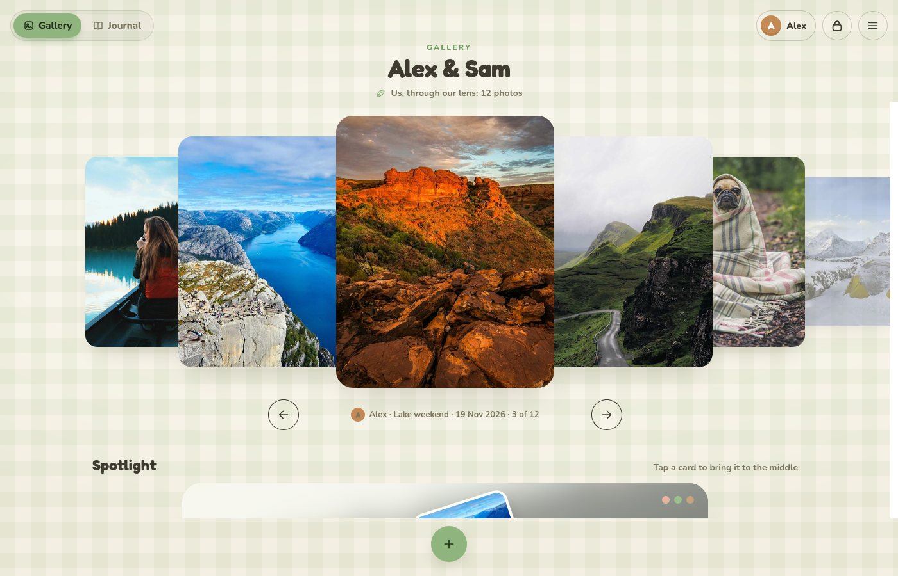
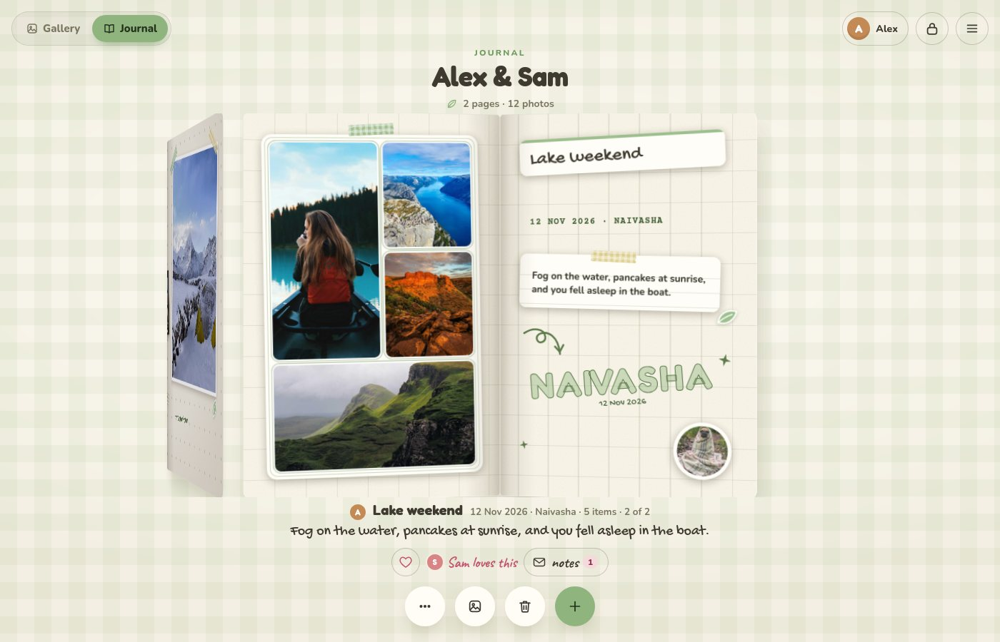
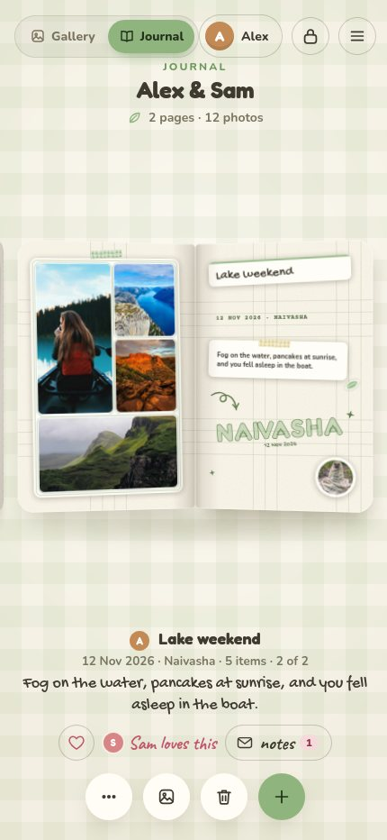

# Little Journal

A private, self-hosted photo gallery and scrapbook journal for two people. Everything stays on your own server.



| Journal page | Love notes | On your phone |
|---|---|---|
|  |  |  |

## What it does
- **Gallery:** a big carousel of every photo and video, a "spotlight" collage, and a grid of everything.
- **Journal:** scrapbook pages you flip through in 3D. Each page has a title, date, place and a little note. There are two layouts, **Mood board** (with the place as a big watermark) and **Film strip**.
- **Hearts and love notes:** heart any photo, video or page. Leave handwritten-style notes with a cute emoji picker. Double-tap a photo to send a big heart.
- **Two people, two passwords:** each of you signs in as yourself. Only the person who added a photo or page can edit or delete it, and deleting asks for your password. Either of you can heart, write notes and change a page's layout.
- **Photos and videos:** big photos are resized in the browser before upload. Videos can be up to 200 MB.
- **Backups:** the server makes a full backup every night. There's also a "Download a backup (.zip)" button in the menu.
- **Works on phones:** add it to your home screen and it opens like an app.
- **Private by default:** nothing is visible without signing in, there are no public sign-ups, photo links expire, and search engines are told not to index it.

## Run your own
You need:
- a small Linux server with Docker, such as a $5–6 a month VPS
- an address that points to it: your own domain, or a free one from [DuckDNS](https://www.duckdns.org)

```sh
git clone https://github.com/Mulandii/ourjournal.git
cd ourjournal
cp .env.example .env
nano .env        # set JOURNAL_HOST and JOURNAL_SETUP_CODE (openssl rand -hex 12)
docker compose up -d
```

1. Open `https://your-address` and you'll see **Set up your journal**.
2. Enter the setup code from `.env`, your journal's name, both of your names and two passwords.
3. You're in. Tell your partner their password; they can change it under ☰ → Change password.

Setup only works while the journal has no accounts, so nobody else can claim it afterwards. You can remove `JOURNAL_SETUP_CODE` from `.env` once you're done.

**Recommended:** create an admin account for the database dashboard at `https://your-address/_/`. You'll use it for backups and settings.
```sh
docker compose exec pocketbase /pb/pocketbase superuser upsert you@example.com 'a-long-password' --dir=/pb_data
```

### Already running Traefik?
Add `COMPOSE_FILE=docker-compose.traefik.yml` to `.env`. It expects an entrypoint called `websecure` and a certificate resolver called `letsencrypt`.

If you'll upload big videos over slow connections, raise Traefik's upload timeout, which defaults to 60 seconds:
`--entrypoints.websecure.transport.respondingTimeouts.readTimeout=900s`.

## Backups and restore
- **Nightly backups:** made at 03:00 in your `TZ`, keeping the last 3. They're in `pb_data/backups`, and you can download or restore them from the dashboard (`/_/` → Settings → Backups). Copy them off the server now and then, because a server disk isn't a backup.
- **Zip backup:** ☰ → Download a backup gives a .zip with every original photo and video, plus `backup.json` with pages, captions, owners, hearts and notes. Passwords are never included.
- **Import a zip backup** into a fresh journal (after setup), for example to move servers:
  ```sh
  PB_URL=https://your-address PB_ADMIN_EMAIL=you@example.com PB_ADMIN_PASSWORD='…' \
    node tools/import_backup.mjs our-little-journal-backup-YYYY-MM-DD.zip
  ```

## Updating
```sh
git pull
docker compose up -d --build
```
Database changes are applied automatically on start.

## How it's built
- **[PocketBase](https://pocketbase.io) (one Go binary):** database, logins, file storage and live updates. Access rules live in `pb_migrations/`, and the setup and cleanup hooks live in `pb_hooks/`.
- **The website:** one file, `pb_public/index.html`, written in plain HTML, CSS and JavaScript. There's no build step.
- **Caddy:** provides HTTPS, or the Traefik variant does.

**Running it locally:**
download [PocketBase](https://github.com/pocketbase/pocketbase/releases) and run:
```sh
JOURNAL_SETUP_CODE=dev-setup-code ./pocketbase serve --dir=pb_data --publicDir=pb_public --migrationsDir=pb_migrations --hooksDir=pb_hooks
```
Then open http://127.0.0.1:8090.

## Notes
- **Privacy:** the two display names are shown on the sign-in screen, as they are everywhere in the app. Everything else needs a password.
- **iPhone photos and videos:** HEIC photos need converting to JPEG first. Phone `.mov` videos upload fine but may not play in every browser.

## License
MIT. See [LICENSE](LICENSE). This project bundles:
- [PocketBase JS SDK](https://github.com/pocketbase/js-sdk) (MIT)
- [JSZip](https://stuk.github.io/jszip/) (MIT)

The fonts are from Google Fonts. Sample photos in the screenshots are from [Unsplash](https://unsplash.com) via Lorem Picsum.
