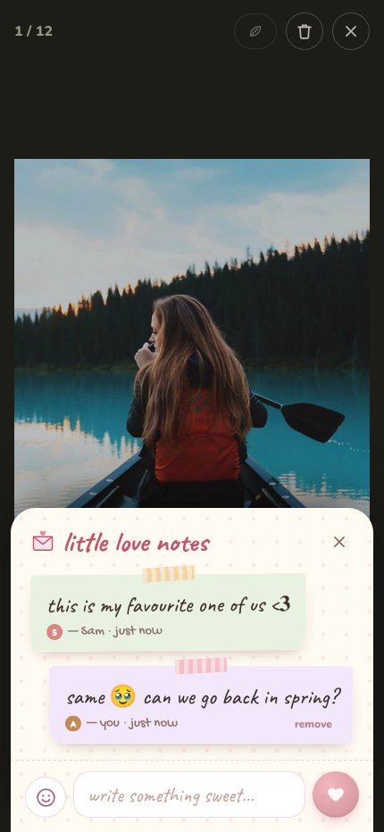
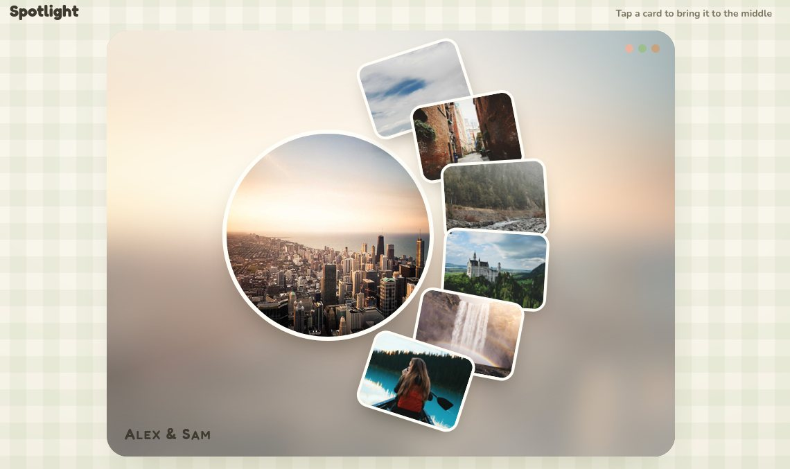
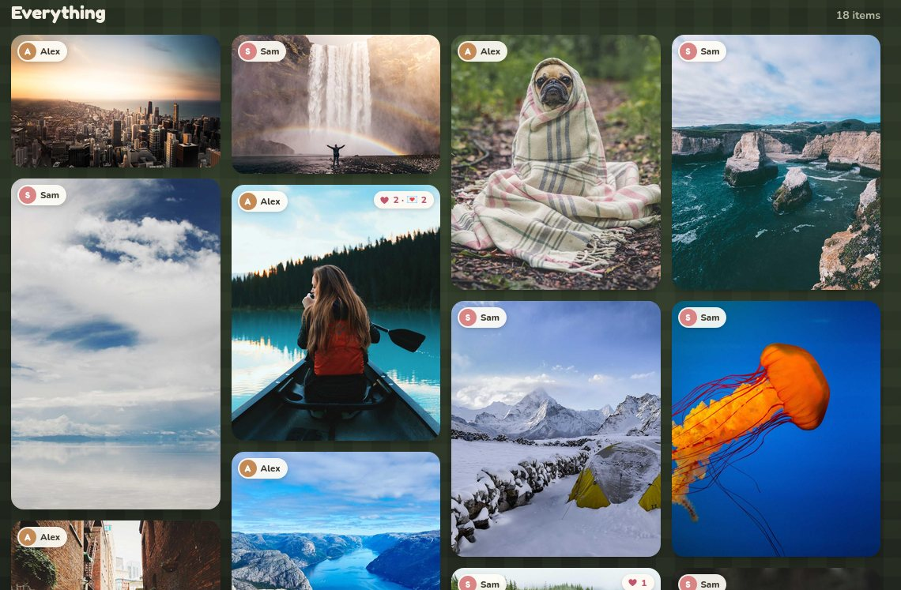

# Little Journal

A private photo gallery and scrapbook journal for two people. Host it free with Vercel + Supabase, or on your own server.


| Journal page | Love notes | On your phone |
|---|---|---|
|  |  |  |

| Spotlight collage | Everything, in dark mode |
|---|---|
|  |  |

## What it does
- **Gallery:** a big carousel of every photo and video, a "spotlight" collage (one photo in a circle with a fan of cards around it), and a grid of everything that keeps each photo's shape.
- **Light and dark:** it follows your phone or computer's theme.
- **Journal:** scrapbook pages you flip through in 3D. Each page has a title, date, place and a little note. There are two layouts, **Mood board** (with the place as a big watermark) and **Film strip**.
- **Hearts and love notes:** heart any photo, video or page. Leave handwritten-style notes with a cute emoji picker. Double-tap a photo to send a big heart.
- **Two people, two passwords:** each of you signs in as yourself. Only the person who added a photo or page can edit or delete it, and deleting asks for your password. Either of you can heart, write notes and change a page's layout.
- **Photos and videos:** big photos are resized in the browser before upload. Videos can be up to 200 MB on your own server, or 50 MB on the free option.
- **Backups:** a "Download a backup (.zip)" button in the menu. Your own server also makes a full backup every night.
- **Works on phones:** add it to your home screen and it opens like an app.
- **Private by default:** nothing is visible without signing in, there are no public sign-ups, photo links expire, and search engines are told not to index it.

## Get your own journal
There are two ways. Pick the one that suits you:

| | **Option 1: Free (Vercel + Supabase)** | **Option 2: Your own server** |
|---|---|---|
| Cost | Free | About $5 a month for a small server |
| Skills needed | None: clicking and copy-paste | Some: using a terminal |
| Space for photos | About 1 GB | As big as your server's disk |
| Longest video | 50 MB (about 30–60 seconds) | 200 MB |
| Backups | Download a zip from the menu | Automatic every night, plus the zip |
| If unused for a week | Supabase pauses it (one click to wake) | Always on |

Free plans can change, so check [Supabase pricing](https://supabase.com/pricing) for today's limits.

### Option 1: Free, no server (Vercel + Supabase)
It takes about 10 minutes and you won't need to write any code. You need three free accounts: [GitHub](https://github.com/signup), [Supabase](https://supabase.com/dashboard/sign-up) and [Vercel](https://vercel.com/signup). The quickest way is to sign in to Supabase and Vercel *with* GitHub.

**1. Make a Supabase project**
- In Supabase, click **New project**.
- Give it a name (e.g. `our-journal`), choose a database password (save it somewhere), and pick the region closest to you.
- Click **Create**, then wait a minute or two while it gets ready.

**2. Create the journal's database**
- Open [`supabase/schema.sql`](supabase/schema.sql), click the **copy** button (top right of the file), and keep that tab open.
- In Supabase, open **SQL Editor**, click **New query**, and paste everything in.
- Find the line that says `'CHANGE-ME'` (near the top). Replace `CHANGE-ME` with your own secret **setup code**, for example `'pancake-violet-harbor'`. Keep the quotes, and use at least 8 characters.
- Click **Run**. It should finish with *"Little Journal is ready ♡"*.

**3. Turn off email confirmation**
- In Supabase, go to **Authentication → Sign In / Providers → Email**.
- Switch **Confirm email** **off** and click **Save**.
- Leave sign-ups on. Only someone with your setup code can create an account, and never more than two.

**4. Copy two values**
- In Supabase, click **Connect** at the top, or open **Project Settings → API Keys**.
- Copy the **Project URL**, which looks like `https://abcdefgh.supabase.co`.
- Copy the **Publishable key** (`sb_publishable_…`), or the older **anon public** key.
- ⚠️ Never use the **secret** or **service_role** key. The deploy will refuse it, to keep you safe.

**5. Put the site online**

[](https://vercel.com/new/clone?repository-url=https%3A%2F%2Fgithub.com%2FMulandii%2Fourjournal&env=SUPABASE_URL,SUPABASE_KEY&envDescription=Your%20Supabase%20Project%20URL%20and%20Publishable%20key%20(see%20the%20README%2C%20step%204)&envLink=https%3A%2F%2Fgithub.com%2FMulandii%2Fourjournal%23option-1-free-no-server-vercel--supabase&project-name=little-journal&repository-name=little-journal)

- Click the button above and sign in to Vercel with GitHub.
- Vercel asks for two values: paste the Project URL into `SUPABASE_URL` and the Publishable key into `SUPABASE_KEY`.
- Click **Deploy**. After about a minute you get a link like `https://little-journal-abc.vercel.app`.

**6. Set up your journal**
- Open your link. You'll see **Set up your journal**.
- Enter your setup code from step 2, your journal's name, both your names and two passwords.
- That's it ♡ Tell your partner their password; they can change it under ☰ → Change password.
- On your phones, open the link and choose **Add to Home screen**.

**Good to know**
- **A nicer address:** in Vercel, go to your project → **Settings → Domains**. You can add your own domain, or rename the `….vercel.app` one.
- **Your photos live in Supabase, not Vercel.** You can redeploy any time without losing anything.
- **The free plan has no automatic backups.** Use ☰ → **Download a backup** every so often.
- **If Supabase pauses the project** after a quiet week, open the Supabase dashboard and click **Restore project**. Your photos are kept.

### Option 2: Your own server (Docker)
You need:
- a small Linux server with Docker, such as a $5–6 a month VPS
- an address that points to it: your own domain, or a free one from [DuckDNS](https://www.duckdns.org)

```sh
git clone https://github.com/Mulandii/ourjournal.git
cd ourjournal
cp .env.example .env
nano .env        # set JOURNAL_HOST and JOURNAL_SETUP_CODE (openssl rand -hex 12)
docker compose up -d
```

1. Open `https://your-address` and you'll see **Set up your journal**.
2. Enter the setup code from `.env`, your journal's name, both of your names and two passwords.
3. You're in. Tell your partner their password; they can change it under ☰ → Change password.

Setup only works while the journal has no accounts, so nobody else can claim it afterwards. You can remove `JOURNAL_SETUP_CODE` from `.env` once you're done.

**Recommended:** create an admin account for the database dashboard at `https://your-address/_/`. You'll use it for backups and settings.
```sh
docker compose exec pocketbase /pb/pocketbase superuser upsert you@example.com 'a-long-password' --dir=/pb_data
```

#### Already running Traefik?
Add `COMPOSE_FILE=docker-compose.traefik.yml` to `.env`. It expects an entrypoint called `websecure` and a certificate resolver called `letsencrypt`.

If you'll upload big videos over slow connections, raise Traefik's upload timeout, which defaults to 60 seconds:
`--entrypoints.websecure.transport.respondingTimeouts.readTimeout=900s`.

## Backups and restore
- **Zip backup (both options):** ☰ → Download a backup.
- **Nightly backups (own server):** made at 03:00 in your `TZ`, keeping the last 3. They're in `pb_data/backups`, and you can download or restore them from the dashboard (`/_/` → Settings → Backups). Copy them off the server now and then, because a server disk isn't a backup.
- **What's in the zip:** every original photo and video, plus `backup.json` with pages, captions, owners, hearts and notes. Passwords are never included.
- **Import a zip backup** into a fresh own-server journal (after setup), for example to move servers:
  ```sh
  PB_URL=https://your-address PB_ADMIN_EMAIL=you@example.com PB_ADMIN_PASSWORD='…' \
    node tools/import_backup.mjs our-little-journal-backup-YYYY-MM-DD.zip
  ```

## Updating
**Option 1 (Vercel + Supabase):**
1. Run the newest [`supabase/schema.sql`](supabase/schema.sql) again in the SQL Editor. It's safe to run again, and you can leave `CHANGE-ME` as it is once you're set up.
2. In Vercel, redeploy. If you deployed with the button, your copy of the code lives in your GitHub; replace its files with the newest ones and Vercel redeploys by itself.

**Option 2 (own server):**
```sh
git pull
docker compose up -d --build
```
Database changes are applied automatically on start.

## How it's built
- **The website:** `pb_public/index.html`, written in plain HTML, CSS and JavaScript, with no framework. `pb_public/config.js` says which backend it talks to.
- **Own server: [PocketBase](https://pocketbase.io).** One Go binary handles the database, logins, file storage and live updates. The access rules are in `pb_migrations/`, and the setup and cleanup hooks are in `pb_hooks/`. Caddy or Traefik provides HTTPS.
- **Free option: [Supabase](https://supabase.com) + [Vercel](https://vercel.com).** `supabase/schema.sql` holds the same rules as database policies. `pb_public/supabase-driver.js` connects the page to Supabase. Vercel serves the page, and `tools/vercel-build.mjs` writes your Supabase details into `config.js`.
- **Same rules either way:** only the owner can edit or delete their photos and pages, either of you can change a layout, and you can only remove your own hearts and notes.

**Running it locally:**
download [PocketBase](https://github.com/pocketbase/pocketbase/releases) and run:
```sh
JOURNAL_SETUP_CODE=dev-setup-code ./pocketbase serve --dir=pb_data --publicDir=pb_public --migrationsDir=pb_migrations --hooksDir=pb_hooks
```
Then open http://127.0.0.1:8090.

## Notes
- **Privacy:** the two display names are shown on the sign-in screen, as they are everywhere in the app. Everything else needs a password.
- **iPhone photos and videos:** HEIC photos need converting to JPEG first. Phone `.mov` videos upload fine but may not play in every browser.

## License
MIT. See [LICENSE](LICENSE). This project bundles:
- [PocketBase JS SDK](https://github.com/pocketbase/js-sdk) (MIT)
- [JSZip](https://stuk.github.io/jszip/) (MIT)
- [supabase-js](https://github.com/supabase/supabase-js) (MIT)

The fonts are from Google Fonts. Sample photos in the screenshots are from [Unsplash](https://unsplash.com) via Lorem Picsum.
